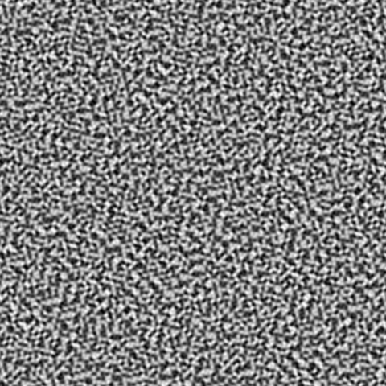

# Noisy - SIMD-accelerated simplex noise.

`nimby install https://github.com/treeform/noisy`


[API reference](https://treeform.github.io/noisy)

## About

Noisy generates seeded simplex noise in one, two, three, and four dimensions.
It supports octave layering through `octaves`, `amplitude`, `frequency`,
`lacunarity`, and `gain`.

Point sampling with `value()` uses scalar arithmetic. Grid generation selects
AVX2 on supported x86-64 CPUs, SSE2 on other x86 CPUs, and NEON on ARM64.
All three backends accelerate all four dimensions, with scalar handling for
leftover edges. Noisy depends on Nimsimd and supports the C and C++ backends
with Nim 2.2 and 2.4.

AVX2 generates eight samples at a time and checks both CPU and operating-system
support before use. Only the AVX2 module receives AVX2 compiler flags, so no
global `-mavx2` flag is needed. Use `-d:noisyNoAvx` to test or benchmark the SSE2
fallback. GCC, Clang, and MSVC builds are supported.

Originally created by Ryan Oldenburg in
[guzba/noisy](https://github.com/guzba/noisy).

> **AI disclaimer: Portions of this library and its tests were developed with AI assistance.**

## Examples

```nim
import noisy

var simplex = initSimplex(1988)
simplex.frequency = 0.1

let line = simplex.grid(-4.5'f, 16)
echo line[3]

let surface = simplex.grid((0, 0), (16, 16))
echo surface[3, 4]

let volume = simplex.grid((0, 0, 0), (8, 8, 8))
echo volume[1, 2, 3]

let animation = simplex.grid((0, 0, 0, 0), (8, 8, 8, 4))
echo animation[1, 2, 3, 0]
```

Grid coordinates advance in unit intervals before applying `frequency`.
The fourth grid dimension is `frames`. Each frame stores one 3D slice, with z
as its fastest-changing coordinate. A 1D grid has height, depth, and frames set
to one. All sampling methods accept integer or float32 coordinates.

See [examples/basic.nim](examples/basic.nim) and
[examples/dimensions.nim](examples/dimensions.nim) for runnable examples.

## Development

Install dependencies from the workspace directory containing your checkout:

```sh
cd ..
nimby create
nimby install noisy/noisy.nimble
cd noisy
```

Run the full test suite through its single entry point:

```sh
nim r tests/tests.nim
```

The suite covers independent reference values, continuity, grid bounds, octave
composition, and scalar/SIMD comparisons across seeds and parameters.

For reproducible comparisons against independent C and C++ implementations,
see [reference tests](tests/reference/README.md). Their pinned sources are
downloaded into an ignored cache and are not committed.

Apple Silicon uses native ARM64 NEON. The same test command works without
architecture flags or Rosetta. CI tests Nim 2.2 and 2.4 in debug and release
builds on native ARM64 macOS and x86 Linux and Windows.

## Benchmarks and image generation

Optional development tools have separate dependencies. From the workspace
parent, install `benchy` for `bench_noisy.nim` or `pixie` for image generation with
`nimby install benchy` or `nimby install pixie`.

Run these commands from the repository root:

```sh
nim r -d:release tests/bench_noisy.nim
nim r tools/gen_noise.nim
```

The generator writes the preview to `docs/noise.png`.

To download the pinned C/C++ references and benchmark scalar sampling, automatic
SIMD, and the SSE2 fallback in one command:

```sh
python tools/gen_references.py --benchmark
```

Sources, build files, logs, and JSON results stay in `tests/reference/.cache/`.
Use `--offline --benchmark` to reuse the verified cache without network access,
or `--cache-dir /tmp/noisy-references` to keep the files outside the checkout.
The benchmark uses Nim's standard library and requires no Benchy dependency.
It reports medians, timing ranges, and speedup ratios for 1D through 4D with one
and three octaves. See the [methodology and results](tests/reference/README.md#timing).

## Documentation

The docs workflow builds the [API reference](https://treeform.github.io/noisy)
from `src/noisy.nim`. To build it locally:

```sh
nim doc --index:on --project --git.url:https://github.com/treeform/noisy \
  --git.commit:master --out:.gh-pages src/noisy.nim
```

## License

Noisy is distributed under the [MIT license](LICENSE).
