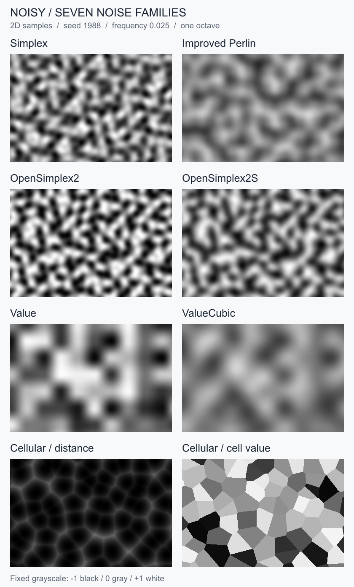

# Noisy - SIMD-accelerated noise for Nim.

`nimby install https://github.com/treeform/noisy`


[API reference](https://treeform.github.io/noisy)

## About

Noisy generates seven families of seeded noise. Simplex and Improved Perlin
support 1D through 4D. OpenSimplex2, OpenSimplex2S, Value, ValueCubic, and
Cellular support 2D and 3D. All share the `octaves`, `amplitude`,
`frequency`, `lacunarity`, and `gain` settings.

Point sampling with `value()` uses scalar arithmetic. On ARM64, `grid()` uses
NEON for every noise family and handles leftover samples with scalar arithmetic.
On x86-64, every noise family uses AVX2 when available. Otherwise Simplex uses
SSE2 and the other families use scalar sampling.
Noisy depends on Nimsimd and supports the C and C++ backends with Nim 2.2 and 2.4.

AVX2 generates eight samples at a time and checks both CPU and operating-system
support before use. Only AVX2 modules receive AVX2 compiler flags, so no
global `-mavx2` flag is needed. Use `-d:noisyNoAvx` to test or benchmark the
SSE2/scalar fallbacks. GCC, Clang, and MSVC builds are supported.

Originally created by Ryan Oldenburg in
[guzba/noisy](https://github.com/guzba/noisy).

> **AI disclaimer: Portions of this library and its tests were developed with AI assistance.**

## Noise gallery

Eight examples in a two-column, four-row grid, generated by Noisy itself.
All use seed `1988`, frequency `0.025`, and one octave. The same grayscale mapping
is used throughout: -1 is black, 0 is gray, and +1 is white; values outside that
range are clipped. Cellular shows both its default squared-distance output and
its `CellValue` mode.



Recreate the gallery with `nim r -d:release tools/gen_gallery.nim` after installing
the optional `pixie` dependency. An optional font path selects the label font.

## Speed

**Milliseconds per 512 x 512 grid, one octave; lower is better.** Recorded on an
AMD Ryzen 9 5900X with Windows, Nim 2.2.10, and GCC/G++ 11.1.0. Noisy uses a
release build with threads enabled. The C/C++ column uses the matching pinned
reference implementation for each family.

| Noise | C/C++ ms | Scalar ms | AVX2 ms |
| --- | ---: | ---: | ---: |
| Simplex | 4.362 | 9.122 | **2.040** |
| Improved Perlin | 2.554 | 7.143 | **1.083** |
| OpenSimplex2 | 3.073 | 7.160 | **1.069** |
| OpenSimplex2S | 3.495 | 7.030 | **1.415** |
| Value | 2.366 | 6.304 | **0.528** |
| ValueCubic | 5.574 | 8.930 | **1.114** |
| Cellular | 5.261 | 17.672 | **1.966** |

Medians of 11 rounds of four grids, including allocation and output writes.
Every timed output was checked against its reference. Results were recorded on
2026-11-18 at `3bd36ec`; performance depends on the CPU, compiler, and workload.
These timings use frequency `0.075` and the benchmark's coordinate range, rather
than the gallery settings. See [methodology and other dimensions](tests/reference/README.md#timing)
and [raw measurements](tests/reference/results/ryzen-5900x-kernel-optimization.json).

## Examples

```nim
import noisy

var simplex = initSimplex(1988)
simplex.frequency = 0.1

let line = simplex.grid(-4.5'f, 16)
echo line[3]

let surface = simplex.grid((0, 0), (16, 16))
echo surface[3, 4]

let volume = simplex.grid((0, 0, 0), (8, 8, 8))
echo volume[1, 2, 3]

let animation = simplex.grid((0, 0, 0, 0), (8, 8, 8, 4))
echo animation[1, 2, 3, 0]
```

Grid coordinates advance in unit intervals before applying `frequency`.
The fourth grid dimension is `frames`. Each frame stores one 3D slice, with z
as its fastest-changing coordinate. A 1D grid has height, depth, and frames set
to one. All sampling methods accept integer or float32 coordinates.

See [examples/basic.nim](examples/basic.nim) and
[examples/dimensions.nim](examples/dimensions.nim) for runnable examples.

The shared gradient and random-vector lookup tables are already constants.
Simplex and Perlin permutation tables depend on the seed. For a fixed seed and
settings, the entire noise object can also be constructed at compile time:

```nim
const noise = initPerlin(42) # initSimplex(42) works too
echo noise.value(0.125'f, 0.25'f)
```

Release builds remove checks and exception bookkeeping from audited sampling
kernels. Public parameter validation remains enabled. See
[kernel safety and verification](docs/kernels.md) for the bounds invariants and
`-d:noisyCheckKernels` verification mode.

## Development

Install dependencies from the workspace directory containing your checkout:

```sh
cd ..
nimby create
nimby install noisy/noisy.nimble
cd noisy
```

Run the full test suite through its single entry point:

```sh
nim r tests/tests.nim
```

The suite covers independent reference values, continuity, grid bounds, octave
composition, and scalar/SIMD comparisons across seeds and parameters.

For reproducible comparisons against independent C and C++ implementations,
see [reference tests](tests/reference/README.md). Their pinned sources are
downloaded into an ignored cache and are not committed.

Apple Silicon uses native ARM64 NEON. The same test command works without
architecture flags or Rosetta. CI tests Nim 2.2 and 2.4 in debug and release
builds on native ARM64 macOS and x86 Linux and Windows.

## Benchmarks and image generation

Optional development tools have separate dependencies. From the workspace
parent, install `benchy` for `bench_noisy.nim` or `pixie` for image generation with
`nimby install benchy` or `nimby install pixie`.

Run these commands from the repository root:

```sh
nim r -d:release tests/bench_noisy.nim
nim r tools/gen_noise.nim
nim r -d:release tools/gen_gallery.nim
```

The generators write the Simplex preview to `docs/noise.png` and the labeled
gallery to `docs/noise-gallery.png`. The gallery uses an installed Arial,
DejaVu Sans, or Liberation Sans font for its labels. To choose another font:

```sh
nim r -d:release tools/gen_gallery.nim /path/to/font.ttf
```

Run the benchmark for all noise families against the pinned C/C++ references.

```sh
nim r tools/gen_references.nim --benchmark
```

Sources, build files, logs, and results stay in `tests/reference/.cache/`.
Use `--offline --benchmark` to reuse the verified cache without network access,
or `--cache-dir /tmp/noisy-references` to keep the files outside the checkout.
The benchmark uses Nim's standard library and writes a Markdown table of median
grid times, with rows for each supported noise and dimension at one and three
octaves. Columns show the C/C++ reference, Noisy scalar, and available Noisy
SIMD backends. [Methodology and results](tests/reference/README.md#timing)

## Documentation

The docs workflow builds the [API reference](https://treeform.github.io/noisy)
from `src/noisy.nim`. To build it locally:

```sh
nim doc --index:on --project --git.url:https://github.com/treeform/noisy \
  --git.commit:master --out:.gh-pages src/noisy.nim
```

## License

Noisy is distributed under the [MIT license](LICENSE).
